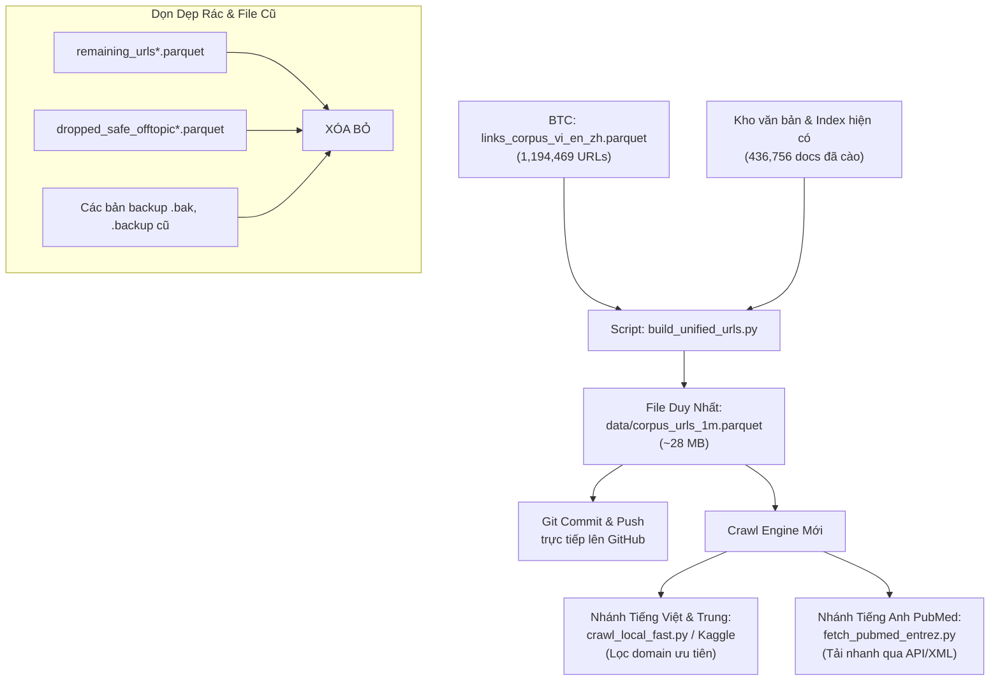

# 📋 KẾ HOẠCH HỢP NHẤT KHO DỮ LIỆU URL: CHUYỂN ĐỔI SANG 1.19M URLS CHUẨN BTC

> **Phiên bản:** 1.0  
> **Ngày lập:** 12/10/2026  
> **Mục tiêu:** Bãi bỏ toàn bộ tập 4.4 triệu URL cũ; xóa bỏ phân chia Tier 1 / Tier 2; chuẩn hóa và hợp nhất 1.194.469 URL chính thức của BTC thành **1 file duy nhất** (< 30 MB) để push trực tiếp lên GitHub; dọn dẹp an toàn các file URL dư thừa.

---

## 1. GIAI ĐOẠN 1: PHÂN TÍCH HIỆN TRẠNG & TÀI NGUYÊN (ANALYSIS)

### 1.1. Sự thay đổi cốt lõi từ Ban Tổ chức

- **Kho dữ liệu cũ (4.4M URLs):** Danh sách ban đầu chứa quá nhiều URL tiếng Trung đại trà và rác, buộc team phải chia tầng (`tier_1`, `tier_2`, `tier_other`) để ưu tiên cào.
- **Kho dữ liệu mới (1.194.469 URLs):**
  - **Tiếng Việt:** 714.469 URLs (giữ nguyên 100%).
  - **Tiếng Trung:** Rút gọn còn 240.000 URLs (cắt giảm hơn 2.5 triệu URLs đại trà).
  - **Tiếng Anh:** Bổ sung mới 240.000 URLs — **100% là bài báo khoa học y sinh từ PubMed (`pubmed.ncbi.nlm.nih.gov`)**.
  - **Mã ID:** Giữ nguyên 100% ID gốc.

### 1.2. Hiện trạng Dữ liệu Thực tế của Team

- **Số bài viết đã cào & đã lập chỉ mục hợp lệ:** **436.756 tài liệu** (chiếm ~36.6% tổng kho 1.19M mới).
- **Số URL còn lại cần thu thập:** **~757.713 URLs**, trong đó:
  - **240.000 URLs PubMed (Tiếng Anh):** Hoàn toàn mới, có cấu trúc PMID rõ ràng, có thể tải qua API/PubMed baseline với tốc độ cực cao.
  - **~517.713 URLs Tiếng Việt & Tiếng Trung còn lại:** Cần phân loại độ ưu tiên theo domain (Long Châu, Medlatec, 120ask, 39.net...).

### 1.3. Tính khả thi khi đưa lên GitHub

- File parquet `links_corpus_vi_en_zh.parquet` có kích thước thực tế chỉ **~26.9 MB**.
- Giới hạn của GitHub:
  - Cảnh báo dung lượng: > 50 MB.
  - Chặn push: > 100 MB.
- 👉 **Kết luận:** File 1.19M URLs dạng Parquet hoàn toàn nằm trong ngưỡng an toàn của GitHub (< 30 MB). Không cần chia file, không cần Git LFS, có thể commit và versioning trực tiếp trên repo chính.

---

## 2. GIAI ĐOẠN 2: THIẾT KẾ CẤU TRÚC FILE DUY NHẤT (PLANNING)

### 2.1. Bãi bỏ cấu trúc Tier 1 / Tier 2

- Trước đây: Cần chia `tier_1`, `tier_2`, `tier_other` vì kho dữ liệu quá khổng lồ (4.4M).
- Hiện nay: Quy mô 1.19M vừa vặn trong tầm kiểm soát. Thay vì chia nhỏ thành nhiều file khó đồng bộ, toàn bộ 1.19M URLs sẽ nằm trong **1 file duy nhất**.
- Mức độ ưu tiên sẽ được quản lý bằng cột `domain` và trường trạng thái `crawled` bên trong file.

### 2.2. Đặc tả File Duy Nhất (`data/corpus_urls_1m.parquet`)

Tệp sẽ được lưu trữ tại đường dẫn chuẩn:

```
data/corpus_urls_1m.parquet
```

**Bảng Schema chuẩn hóa:**

| Tên Cột   | Kiểu Dữ Liệu | Ý Nghĩa                                 | Ví Dụ                                                |
| :-------- | :----------- | :-------------------------------------- | :--------------------------------------------------- |
| `id`      | `int64`      | Mã định danh chuẩn của BTC (Khóa chính) | `583`, `100234`                                      |
| `url`     | `string`     | Đường dẫn bài viết gốc                  | `https://pubmed.ncbi.nlm.nih.gov/382910/`            |
| `domain`  | `string`     | Tên miền trích xuất từ URL              | `pubmed.ncbi.nlm.nih.gov`, `nhathuoclongchau.com.vn` |
| `lang`    | `string`     | Ngôn ngữ phân loại (`vi`, `en`, `zh`)   | `'en'`, `'vi'`, `'zh'`                               |
| `crawled` | `bool`       | Đã có trong kho dữ liệu văn bản chưa    | `True` / `False`                                     |

---

## 3. GIAI ĐOẠN 3: GIẢI PHÁP KỸ THUẬT & DỌN DẸP (SOLUTIONING)



### 3.1. Kế hoạch Dọn dẹp File (File Cleanup Strategy)

Chỉ xóa các file danh sách URL phân mảnh và các bản backup dư thừa; **tuyệt đối bảo toàn dữ liệu văn bản đã cào**:

- 🗑️ **Các file URL cũ CẦN XÓA:**
  1. `data/raw/final_corpus_text/remaining_urls.parquet` & `.bak`
  2. `data/raw/final_corpus_text/remaining_urls_fast.parquet` & `.bak`
  3. `data/raw/final_corpus_text/remaining_urls_selenium.parquet` & `.bak`
  4. `data/raw/final_corpus_text/dropped_safe_offtopic_urls.parquet` & `.bak`
  5. Các file URL chia batch/split nhỏ tạm thời trước đây.

- 🛡️ **Các file DỮ LIỆU CẦN BẢO VỆ (KHÔNG XÓA):**
  1. `data/raw/final_corpus_text/tier_1.parquet` (Dữ liệu text đã cào).
  2. `data/raw/final_corpus_text/tier_2.parquet` (Dữ liệu text đã cào).
  3. `data/raw/final_corpus_text/tier_1_resume.parquet` (30.4k bài Long Châu & 39.net chuẩn bị embed).
  4. Toàn bộ thư mục `data/indices/` (20 khối shard vector).

### 3.2. Chiến lược Thu thập URLs còn thiếu

1. **Đối với 240.000 bài PubMed (Tiếng Anh):**
   - Viết script `scripts/fetch_pubmed_entrez.py`.
   - Trích xuất `pmid` trực tiếp từ URL bằng regex: `pubmed.ncbi.nlm.nih.gov/(\d+)`.
   - Dùng NCBI Entrez E-Utilities (`efetch`) tải batch 500-1000 abstracts/request.
   - Không bị Cloudflare chặn, tốc độ cào ~10.000 bài/phút, hoàn thành 240k bài chỉ trong ~30-40 phút.
2. **Đối với URLs Tiếng Việt & Tiếng Trung chưa cào:**
   - Cập nhật `scripts/crawl_local_fast.py` và `kaggle_crawler_notebook.ipynb` nhận đầu vào duy nhất từ `data/corpus_urls_1m.parquet`.
   - Chỉ lọc những hàng có `crawled == False`.
   - Khi cần ưu tiên domain nào, chỉ cần truyền cờ `--domain nhathuoclongchau.com.vn`.

---

## 4. GIAI ĐOẠN 4: LỘ TRÌNH TRIỂN KHAI (IMPLEMENTATION ROADMAP)

| Bước       | Hành Động                                      | Công Cụ / Script                                       | Đầu Ra Dự Kiến                                           |
| :--------- | :--------------------------------------------- | :----------------------------------------------------- | :------------------------------------------------------- |
| **Bước 1** | Viết script tạo file URL hợp nhất              | `scripts/build_unified_urls.py`                        | Tạo `data/corpus_urls_1m.parquet`                        |
| **Bước 2** | Quét kho text đối soát trạng thái `crawled`    | Tích hợp trong `build_unified_urls.py`                 | Cập nhật chính xác cột `crawled` (436k True, 757k False) |
| **Bước 3** | Dọn dẹp an toàn các file URL cũ và file `.bak` | `scripts/cleanup_legacy_urls.py`                       | Giải phóng ~30-50 MB dung lượng rác                      |
| **Bước 4** | Kiểm tra kích cỡ file & Push lên GitHub        | `git add data/corpus_urls_1m.parquet` & `git commit`   | Kho GitHub được chuẩn hóa theo chuẩn mới                 |
| **Bước 5** | Cập nhật script cào Local & Notebook Kaggle    | `crawl_local_fast.py`, `kaggle_crawler_notebook.ipynb` | Toàn bộ pipeline cào trỏ về file URL duy nhất            |
| **Bước 6** | Triển khai pipeline cào 240k PubMed            | `scripts/fetch_pubmed_entrez.py`                       | Hoàn thiện nguồn dữ liệu tiếng Anh                       |

---

> [!TIP]
> **Lợi ích dài hạn:**
>
> - Mã nguồn và tài nguyên dữ liệu trở nên cực kỳ tinh gọn, đồng bộ giữa máy Local và các môi trường Cloud (Kaggle/Colab).
> - Tránh hoàn toàn việc cào nhầm vào 2.5 triệu URL tiếng Trung đã bị loại bỏ.
> - Tiết kiệm băng thông, tài nguyên lưu trữ và thời gian tính toán embedding.
