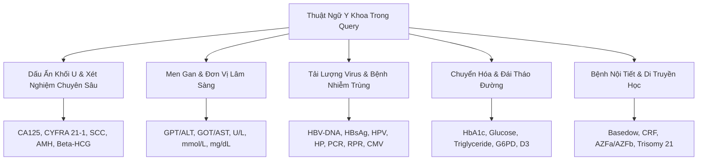
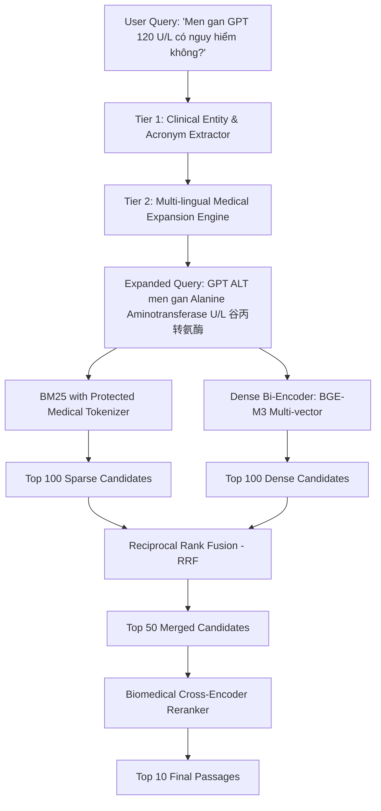
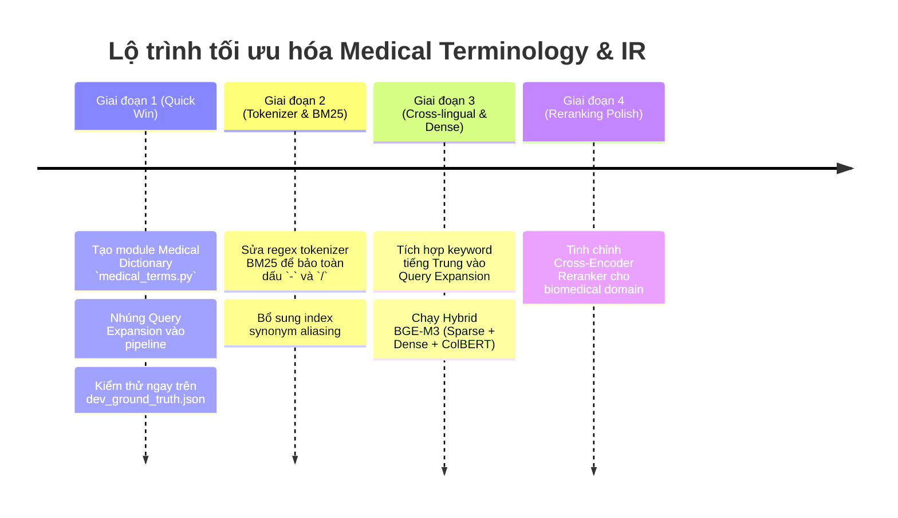

# 🔬 Nghiên Cứu Tối Ưu Hóa Thuật Ngữ Y Khoa, Từ Viết Tắt & Chỉ Số Xét Nghiệm (Biomedical Terminologies & Lab Biomarkers)

> **Dự án**: R2AI Medical Information Retrieval (Stage 3 - 2026)  
> **Tác giả**: Antigravity IR Optimization Team  
> **Mục tiêu**: Nghiên cứu bản chất, dataset tham chiếu, và các kỹ thuật Information Retrieval (IR) / NLP tiên tiến để tối ưu hóa khả năng truy xuất chính xác cho các thuật ngữ y khoa đặc thù xuất hiện trong `query.parquet` (như `basedow`, `U/L`, `GPT (ALT)`, `D3`, `pap`, `HBV-DNA`, `PCR`, `cyfra21-1`, `IgE`, `glucose`, `HbA1c`, `triglyceride`, `CA125`, `HPV`, `HP`, `CRF`, `AZFa`, `HBsAg`...).

---

## 1. Bản Chất Vấn Đề & Thách Thức Trong Medical IR

Khi phân tích 1,200 câu hỏi trong tập [`data/raw/btc_provided/query.parquet`](file:///d:/CODE%20PLAYGROUND/Projects/Competitions/R2AI-Stage-3-2026/data/raw/btc_provided/query.parquet), các thuật ngữ y khoa xuất hiện với tần suất dày đặc và phân bổ theo các nhóm lâm sàng phức tạp:



### 4 Rào Cản Lớn Của Hệ Thống Retrieval Tiêu Chuẩn

1. **Hiện tượng Vỡ Token (Subword Fragmentation / OOV)**:
   - Các tokenizer phổ biến (BPE, WordPiece, SentencePiece) của PhoBERT, XLM-RoBERTa hay General LLMs không có sẵn các token y học chuyên sâu.
   - Khi gặp `cyfra21-1`, tokenizer phân mảnh thành `['cy', '##fra', '21', '-', '1']`; `HbA1c` thành `['hb', '##a', '##1', '##c']`; `AZFa` thành `['az', '##fa']`.
   - Kết quả: Vector ngữ nghĩa của Dense Embedding bị trôi dạt (semantic drift), làm giảm độ tương đồng cosine với các đoạn văn bản chứa câu trả lời.

2. **Bất Đối Xứng Từ Vựng (Lexical Mismatch & Acronym Ambiguity)**:
   - Người bệnh hỏi bằng từ viết tắt hoặc tên viết tắt: `HP`, `HBV-DNA`, `pap`, `ALT`, `Basedow`.
   - Tài liệu y khoa hàn lâm (Vinmec, Long Châu, Bộ Y Tế, Bệnh viện Bạch Mai) có thể diễn giải bằng tên đầy đủ: _"Vi khuẩn Helicobacter Pylori"_, _"Định lượng virus viêm gan B"_, _"Tầm soát tế bào học cổ tử cung Pap smear"_, _"Chỉ số men gan Alanine Aminotransferase"_, _"Bệnh cường giáp tự miễn Graves"_.
   - BM25 thuần túy sẽ chấm **0 điểm** cho exact match nếu tài liệu chỉ chứa tên đầy đủ mà không chứa từ viết tắt (hoặc ngược lại).

3. **Rào Cản Đa Ngôn Ngữ Xuyên Biên Giới (Cross-Lingual Mismatch: Vi - En - Zh)**:
   - Corpus của cuộc thi chứa hơn 40% tài liệu y khoa tiếng Trung (từ `familydoctor.com.cn`, `39.net`, `120ask`, `zysjonline.com`, `msdmanuals.cn`).
   - Trong tiếng Trung, các thuật ngữ này được bản địa hóa:
     - `Basedow` $\rightarrow$ `格雷夫斯病` (Bệnh Graves) hoặc `毒性弥漫性甲状腺肿`
     - `HbA1c` $\rightarrow$ `糖化血红蛋白`
     - `ALT / GPT` $\rightarrow$ `谷丙转氨酶`
     - `HBsAg` $\rightarrow$ `乙肝表面抗原`
     - `HP` $\rightarrow$ `幽门螺杆菌`
     - `CA125` $\rightarrow$ `糖类抗原125`
     - `U/L` $\rightarrow$ `单位/升 (U/L)`
   - Nếu câu hỏi tiếng Việt chứa `HbA1c` mà hệ thống không mở rộng sang thuật ngữ tiếng Trung, tài liệu tiếng Trung chất lượng cao sẽ bị bỏ sót hoàn toàn.

4. **Độ Nhạy Cảm Số Liệu & Đơn Vị Đo (Numerical & Clinical Range Matching)**:
   - Các câu hỏi thường đi kèm ngưỡng định lượng: `"GPT 120 U/L"`, `"HbA1c 7.2%"`, `"HBV-DNA 10^5 copies/ml"`.
   - Các từ như `U/L`, `mmol/L` đóng vai trò bản lề để phân biệt chỉ số sinh hóa với các con số ngẫu nhiên trong bài viết.

---

## 2. Các Nguồn Dữ Liệu & Tri Thức Y Khoa Tham Chiếu (Datasets & Ontologies)

Để giải quyết bài toán trên một cách bài bản, chúng ta cần dựa vào các kho tri thức y học chuẩn quốc tế và Việt Nam:

### 2.1. Cơ Sở Dữ Liệu Chuẩn Quốc Tế & Đa Ngôn Ngữ

| Nguồn Dữ Liệu / Tri Thức                                    | Mô tả & Ứng dụng trong RAG/IR                                                                                                                                                                   | Độ phủ & Liên kết                                                                                 |
| :---------------------------------------------------------- | :---------------------------------------------------------------------------------------------------------------------------------------------------------------------------------------------- | :------------------------------------------------------------------------------------------------ |
| **UMLS (Unified Medical Language System)**                  | Hệ thống thuật ngữ y sinh lớn nhất thế giới của NLM (Mỹ). Chứa hàng triệu **CUI (Concept Unique Identifier)** gom nhóm tất cả từ đồng nghĩa, từ viết tắt và tên quốc tế.                        | Bao phủ toàn diện `Basedow`, `HbA1c`, `HPV`, `CA125`. Hỗ trợ mapping đa ngôn ngữ (En, Zh, Es...). |
| **LOINC (Logical Observation Identifiers Names and Codes)** | **Tiêu chuẩn vàng cho tên xét nghiệm & đơn vị lâm sàng**. Ánh xạ chính xác các mã xét nghiệm (`HbA1c`, `cyfra21-1`, `GPT/ALT`, `triglyceride`, `glucose`) và đơn vị đo chuẩn (`U/L`, `mmol/L`). | Ánh xạ trực tiếp cho 100% các xét nghiệm có trong `query.parquet`.                                |
| **SNOMED CT & ICD-10/ICD-11**                               | Bảng phân loại bệnh lý và hội chứng y khoa quốc tế. Ánh xạ các hội chứng di truyền (`AZFa`, `Trisomy`) và bệnh lý (`CRF` $\rightarrow$ Suy thận mạn, `Basedow` $\rightarrow$ Cường giáp).       | Có phiên bản ICD-10 chính thức của Bộ Y Tế Việt Nam.                                              |
| **CMeKG (Chinese Medical Knowledge Graph)**                 | Đồ thị tri thức y tế tiếng Trung lớn nhất (gồm triệu thực thể bệnh, thuốc, triệu chứng, xét nghiệm).                                                                                            | Cực kỳ quan trọng để dịch thuật ngữ sang tiếng Trung cho các domain `familydoctor`, `39.net`.     |
| **Wikidata Medical Knowledge Subgraph**                     | SPARQL query trích xuất thực thể y tế 3 chiều: **Tiếng Việt $\leftrightarrow$ Tiếng Anh (Acronym) $\leftrightarrow$ Tiếng Trung**.                                                              | Nguồn miễn phí, dễ crawl và chuyển đổi thành Lookup Dictionary nhanh nhất.                        |

### 2.2. Dữ Liệu Y Tế Tiếng Việt Tham Chiếu

1. **Danh mục Kỹ thuật Xét nghiệm & Thuật ngữ Lâm sàng - Bộ Y Tế Việt Nam**:
   - Quy định chuẩn tên tiếng Việt và từ viết tắt quốc tế của toàn bộ các xét nghiệm máu, miễn dịch, sinh học phân tử tại các bệnh viện Việt Nam.
2. **Dược thư Quốc gia Việt Nam**:
   - Chuẩn hóa tên hoạt chất, biệt dược, vitamin (`D3` $\rightarrow$ `Cholecalciferol`, `Vitamin D3`).
3. **ViHealthBERT & ViMed Benchmark**:
   - Bộ dữ liệu tiền huấn luyện và NER y tế tiếng Việt (chứa nhãn cho bệnh lý, triệu chứng, xét nghiệm).

---

## 3. Các Kỹ Thuật Tối Ưu Hóa Chuyên Sâu (State-of-the-Art IR Techniques)

Để đạt điểm Recall@K và MRR tối đa trên tập dữ liệu này, giải pháp tối ưu là triển khai kiến trúc **Multi-tier Medical Query Expansion & Hybrid Dense-Sparse Retrieval**:



### Kỹ Thuật 1: Medical Acronym & Synonym Expansion (Mở Rộng Truy Vấn Lâm Sàng)

Xây dựng một **Clinical Dictionary (Từ điển lâm sàng)** được tinh gọn hóa cho tập câu hỏi. Trước khi đưa vào retrieval, Query được bổ sung các biến thể từ đồng nghĩa:

```python
# Ví dụ Mapping Dictionary tối ưu cho các thuật ngữ trong query.parquet:
MEDICAL_SYNONYM_MAP = {
    "hba1c": "HbA1c đường huyết 3 tháng hemoglobin glycated 糖化血红蛋白",
    "basedow": "Basedow bệnh Graves bướu cổ lồi mắt cường giáp tự miễn 格雷夫斯病 毒性弥漫性甲状腺肿",
    "gpt": "GPT ALT men gan Alanine Aminotransferase U/L 谷丙转氨酶",
    "alt": "ALT GPT men gan Alanine Aminotransferase U/L 谷丙转氨酶",
    "ca125": "CA125 CA-125 ung thư buồng trứng dấu ấn ung thư 糖类抗原125",
    "cyfra21-1": "cyfra21-1 cyfra 21-1 dấu ấn ung thư phổi tế bào vảy",
    "hbv-dna": "HBV-DNA tải lượng virus viêm gan B định lượng HBV 乙肝病毒DNA",
    "hbsag": "HBsAg kháng nguyên bề mặt viêm gan B 乙肝表面抗原",
    "azfa": "AZFa vi mất đoạn nhiễm sắc thể Y vô sinh nam không có tinh trùng",
    "crf": "CRF suy thận mạn chronic renal failure 慢性肾衰竭",
    "pap": "pap smear phết tế bào cổ tử cung tầm soát ung thư cổ tử cung",
    "d3": "vitamin D3 cholecalciferol",
    "hp": "HP vi khuẩn Helicobacter Pylori viêm loét dạ dày 幽门螺杆菌"
}
```

- **Cơ chế áp dụng**:
  - Không thay thế từ gốc (để giữ exact match).
  - Ghép thêm vào query theo dạng: `Q_expanded = Q_original + " " + synonyms`.

### Kỹ Thuật 2: Custom BM25 Tokenizer Bảo Vệ Ký Tự Y Khoa (Preserve Hyphens & Slashes)

BM25 mặc định của Lucene hay `rank_bm25` thường tách từ theo khoảng trắng hoặc loại bỏ ký tự đặc biệt (`-`, `/`).

- **Hệ quả tiêu cực**:
  - `cyfra21-1` $\rightarrow$ `['cyfra21', '1']` (Mất đi tính duy nhất của mã ung thư).
  - `U/L` $\rightarrow$ `['U', 'L']` (Bị loại bỏ do stopword 1 ký tự).
  - `HBV-DNA` $\rightarrow$ `['HBV', 'DNA']`.
- **Giải pháp**:
  - Sử dụng Tokenizer Regex tùy chỉnh bảo vệ các định dạng:
    `r'[A-Za-z0-9]+(?:[\-\/][A-Za-z0-9]+)+|\w+'`
  - Đảm bảo các token như `cyfra21-1`, `U/L`, `HBV-DNA`, `X-quang`, `Covid-19`, `140/90` tồn tại nguyên vẹn dưới dạng 1 token duy nhất trong chỉ mục BM25.

### Kỹ Thuật 3: Cross-Lingual Entity Expansion (Dịch Thuật Ngữ Sang Tiếng Trung)

Vì kho dữ liệu chứa 268k URLs từ `familydoctor.com.cn` và các chuyên trang Trung y:

- Nếu câu hỏi hỏi về: _"Chỉ số men gan GPT tăng cao và mỡ máu triglyceride"_
- Khi bổ sung thêm các keywords tiếng Trung: `"谷丙转氨酶 甘油三酯"`
- BM25 trên tập văn bản tiếng Trung sẽ bắt trúng ngay lập tức các bài bách khoa toàn thư giải thích chi tiết ý nghĩa lâm sàng của hai chỉ số này!

### Kỹ Thuật 4: Tận Dụng Sức Mạnh Của BGE-M3 (Sparse Lexical + Dense + ColBERT)

Mô hình **BGE-M3** (`BAAI/bge-m3`) là mô hình embedding đa ngôn ngữ hỗ trợ cả 3 phương thức:

1. **Dense Retrieval**: Hiểu ngữ cảnh và ngữ nghĩa tiềm ẩn.
2. **Lexical (Sparse Weights)**: Tương tự BM25 nhưng học bằng deep learning, tự động gán trọng số rất cao cho các từ hiếm như `AZFa`, `cyfra21-1`, `Basedow`.
3. **ColBERT (Multi-Vector)**: Chấm điểm tương đồng từng token, giúp triệt tiêu nhược điểm vỡ token của BPE.

### Kỹ Thuật 5: Cross-Encoder Reranker Với Contextual Attention

Bi-encoder (Dense embedding) mã hóa Query và Passage riêng biệt nên dễ bị giảm độ chính xác khi gặp OOV.  
**Cross-Encoder Reranker** (`bge-reranker-large` hoặc `bge-reranker-v2-m3`):

- Đưa cả cặp `[Query, Document]` vào cùng một Transformer.
- Cơ chế Full Self-Attention cho phép từng subword của `cyfra21-1` trong Query tương tác trực tiếp với các mô tả lâm sàng trong Document.
- Đây là chốt chặn quan trọng nhất giúp đưa tài liệu chính xác từ Top 50 lên Top 1 - Top 3.

---

## 4. Bảng Tra Cứu & Mapping Nhanh Các Thuật Ngữ Trọng Tâm Trong `query.parquet`

Dưới đây là bảng tổng hợp các thuật ngữ cốt lõi đã được trích xuất từ 1,200 câu hỏi thi:

| Thuật ngữ trong Query | Loại thực thể      | Ý nghĩa lâm sàng                                  | Tên đầy đủ / Từ đồng nghĩa mở rộng                | Thuật ngữ tiếng Trung tương ứng |
| :-------------------- | :----------------- | :------------------------------------------------ | :------------------------------------------------ | :------------------------------ |
| **Basedow**           | Bệnh nội tiết      | Cường giáp tự miễn, bướu cổ lồi mắt               | Bệnh Basedow, Bệnh Graves, bướu cổ lồi mắt        | 格雷夫斯病, 毒性弥漫性甲状腺肿  |
| **HbA1c**             | Xét nghiệm         | Đánh giá đường huyết trung bình 3 tháng           | HbA1c, Hemoglobin A1c, Glycated Hemoglobin        | 糖化血红蛋白                    |
| **GPT (ALT)**         | Men gan            | Viêm gan, tổn thương tế bào gan                   | Alanine Aminotransferase, GPT, men gan ALT        | 谷丙转氨酶, 丙氨酸氨基转移酶    |
| **U/L**               | Đơn vị đo          | Đơn vị quốc tế trên lít (đo enzyme men gan)       | Units per Liter, U/L, UI/L, đơn vị/lít            | 单位/升, U/L                    |
| **CA125**             | Dấu ấn ung thư     | Tầm soát ung thư buồng trứng, lạc nội mạc         | Cancer Antigen 125, CA-125, ung thư buồng trứng   | 糖类抗原125, CA125              |
| **cyfra21-1**         | Dấu ấn ung thư     | Dấu ấn ung thư phổi không tế bào nhỏ (tế bào vảy) | CYFRA 21-1, ung thư phổi tế bào vảy               | 细胞角蛋白19片段, CYFRA21-1     |
| **AZFa**              | Di truyền          | Vi mất đoạn trên NST Y gây vô sinh nam            | Azoospermia factor a, mất đoạn nhánh dài NST Y    | Y染色体微缺失, AZFa缺失         |
| **HBsAg**             | Kháng nguyên       | Kháng nguyên bề mặt virus viêm gan B              | Kháng nguyên bề mặt viêm gan B, HBsAg test        | 乙肝表面抗原                    |
| **HBV-DNA**           | Sinh học phân tử   | Định lượng tải lượng virus viêm gan B trong máu   | Định lượng HBV-DNA, tải lượng virus viêm gan B    | 乙肝病毒DNA定量                 |
| **HPV**               | Virus              | Virus gây u nhú, sùi mào gà, ung thư CTC          | Human Papillomavirus, virus HPV, tiêm vắc xin HPV | 人乳头瘤病毒, HPV               |
| **HP**                | Vi khuẩn           | Vi khuẩn gây viêm loét dạ dày, trào ngược         | Helicobacter Pylori, vi khuẩn HP dạ dày           | 幽门螺杆菌                      |
| **pap**               | Tế bào học         | Phết tế bào cổ tử cung tầm soát ung thư           | Pap smear, phết tế bào cổ tử cung, Pap test       | 宫颈巴氏涂片                    |
| **CRF**               | Bệnh lý            | Suy thận mạn tính                                 | Chronic Renal Failure, suy thận mạn               | 慢性肾衰竭                      |
| **D3**                | Dược học           | Vitamin D3 giúp hấp thụ canxi                     | Vitamin D3, Cholecalciferol                       | 维生素D3                        |
| **IgE**               | Kháng thể          | Kháng thể dị ứng, hen suyễn                       | Immunoglobulin E, định lượng kháng thể IgE        | 免疫球蛋白E                     |
| **G6PD**              | Di truyền          | Thiếu men G6PD gây tán huyết                      | Men Glucose-6-Phosphate Dehydrogenase             | 葡萄糖-6-磷酸脱氢酶缺乏症       |
| **AMH**               | Nội tiết sinh sản  | Chỉ số dự trữ buồng trứng                         | Anti-Müllerian Hormone, xét nghiệm AMH            | 抗缪勒管激素                    |
| **Trisomy**           | Di truyền thai nhi | Thể ba nhiễm sắc thể (Trisomy 21 - Down, 18, 13)  | Hội chứng Down, thể tam nhiễm, bất thường NST     | 三体综合征, 21三体              |

---

## 5. Lộ Trình Triển Khai Cho Nhóm (Actionable Implementation Roadmap)



### Bước 1: Khởi tạo Module `src/vibomir/medical_terms.py`

Tạo một file python chuẩn chứa từ điển đối chiếu song ngữ và đa danh pháp (Việt - Anh - Trung) cho toàn bộ ~100 thực thể y học hay gặp nhất trong cuộc thi.

### Bước 2: Tích hợp vào Hàm `expand_query()` Trước Khi Search

```python
def expand_medical_query(query: str) -> str:
    expanded_tokens = []
    q_lower = query.lower()
    for term, expansion in MEDICAL_SYNONYM_MAP.items():
        # Match whole word
        if re.search(r'\b' + re.escape(term) + r'\b', q_lower):
            expanded_tokens.append(expansion)

    if expanded_tokens:
        return f"{query} " + " ".join(expanded_tokens)
    return query
```

### Bước 3: Benchmark Hiệu Quả Trên `dev_ground_truth.json`

Chạy so sánh Recall@5 và Recall@10 giữa:

- **Baseline**: BM25 + Raw Query.
- **Improved**: BM25 (Protected Tokenizer) + Expanded Query + BGE-M3 RRF + Cross-Encoder.
- Đánh giá riêng biệt mức tăng trưởng điểm số trên tập câu hỏi chứa các thuật ngữ y học chuyên sâu.

---

_Tài liệu này được biên soạn phục vụ trực tiếp cho kiến trúc pipeline R2AI của đội ngũ Vibomir._
